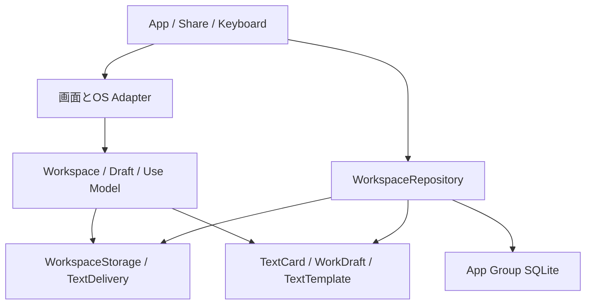

# アプリケーションの構成

nibbleは、本体を文章準備と利用の既定経路とし、共有拡張を取り込み、任意のKeyboardを頻用固定文の挿入へ接続する。確定済みの文章と途中作業、完成文と外部作用を分ける。[製品仕様](../product-specification.md)が利用者から見た契約、ここではコードと状態の責務を定める。

## 全体構成の選択

準備・発見・確認・利用・回復までをつないだ構成として比較した。

| 方式 | 一連の利用への寄与 | 増える負担・採否の理由 |
| --- | --- | --- |
| 本体と共有、コピー／OSのペースト | 標準IMEで作成・編集・差し替えを行い、途中作業を分け、全文確認後に他アプリへ届ける。Keyboard設定なしで開始できる | アプリへ戻り、入力欄を選びペーストする判断が必要。すべての文章に使う既定経路として採用 |
| 上記に、ピン留め固定文専用Keyboardを追加 | 頻用固定文では入力先を離れず、全文確認して明示挿入する。準備と回復は本体へ集約する | 初回のOS設定、ピンの整理、最大50件という範囲の理解が必要。利用者が選ぶ追加経路として採用。使えない入力先は既定経路へ戻る |
| Keyboardで検索・差し替え・入力も完結 | 入力先で完結できればアプリの往復を減らせる | カスタムKeyboard内の入力欄からOS標準の日本語変換へ自然に接続する試作が成立しなかった。独自IMEは訂正・学習・入力範囲・保守の負担を増やすため不採用 |

採用構成にも、本体への往復、全文の読取り、ピンの管理は残る。操作数だけで優位とは判断しない。対象OSでの入力・配送・取消の観測と、検索・長文表示・反復の測定を分けて[検証](../ios-verification.md)する。

## コードの配置

| 配置 | 責務と主な型 |
| --- | --- |
| `app/Nibble/NibbleApp.swift`、`app/Nibble/Workspace/` | 本体の依存生成、起動、検索可能な一覧、作業の再開、確認とコピー、管理。`WorkspaceEntryView`、`WorkspaceHomeView`、`WorkspaceUseView` |
| `app/NibbleShare/` | providerからの原文取得、耐久的な新規作業、共通エディター、共有元への終了 |
| `app/NibbleKeyboard/` | 読取専用の固定文一覧と全文、入力先の同一性・可視性を照合した明示挿入 |
| `app/Shared/Domain/` | `TextCard`、`WorkDraft`、`TextTemplate`、一覧要求、失敗。原文・差し替え・入力順序の規則 |
| `app/Shared/Application/` | `WorkspaceModel`、`DraftSessionModel`、`UseSessionModel`。取得の採否、保存、準備、回復と一度のコピー |
| `app/Shared/Application/Contracts/` | `WorkspaceStorage`と`TextDelivery`。UIや具体的なSQLite接続を持たない操作境界 |
| `app/Shared/Persistence/` | `WorkspaceRepository`。App Group、schema、短い接続、SQL、versionとsequenceのtransaction照合 |
| `app/Shared/Editing/` | 本体と共有で使う`WorkspaceEditorView`、`NativeDocumentField`のUIKit標準入力接続 |
| `app/Shared/Interface/` | 操作結果・対象名・失敗理由と回復案内を表示文言へ変換 |
| `app/Animations/`、`runtime/rive/` | 制作・検証資産。製品画面の入力・保存・利用経路には組み込まない |

`Shared`はソースの共有単位で、全ファイルを全targetへリンクする指定ではない。各targetは必要なDomain・Contracts・実装だけを選ぶ。Keyboardへ編集用UI、独自IME、Rive、課金・広告を持ち込まない。

## 依存と操作の境界

入口が保存層とOS adapterを生成して渡す。モデルは操作・状態の採否、Viewは操作開始と表示の寿命、保存層は接続・transaction、UIKit接続はOS入力を所有する。表示用の原文を保存層へ逆変換して書き込まない。

`WorkspaceStorage`は読込、作業開始・checkpoint・確定保存・破棄、ピン・ごみ箱・復元、Keyboard用読取、実行前再照合を提供する。`TextDelivery`は本体のコピーを表す。OS作用とDB更新を一つのtransactionとして扱わない。

## 概念ごとの正本と更新経路

| 概念 | 正本・更新経路 | 寿命と派生値 |
| --- | --- | --- |
| 保存済み文章と版 | DBの`cards`、`TextCard` | 読み取った版の不変snapshot。編集入力で変更せず、明示保存や整理操作でversionを進める |
| 新規・編集・準備作業 | DBの`work_drafts`、`WorkDraft.Target` | 独立UUIDとsequence。編集・準備は対象UUIDと開始versionを持ち、元文章の変更へ自動追随しない |
| 名前・本文・入力値の同一性 | `WorkDraft`のUTF-8比較 | 表示用の折返し、検索の正規化、Swift Stringの正規等価性へ置き換えない |
| 差し替え規則 | `TextCard.usesVariables`・`WorkDraft.usesVariables`と`TextTemplate` | 明示指定が有効なときだけ印を解釈。既定オフなら原文のまま使う。同名は一欄、印以外のバイトと入力値を保持 |
| 一覧・検索 | `WorkspaceQuery`と`WorkspaceModel` | 選択中集合内の部分一致、50件単位。取得IDで古い結果を拒否。件数とページは同じDB時点 |
| 編集と確定 | `DraftSessionModel` | 入力・明示的な差し替え指定・checkpoint済みsequence・未確定入力・busy・失敗。失敗時は入力を保持して独立保存へ接続 |
| 準備とコピー | `UseSessionModel` | 値の下書きと完成文、元の版、busy、copied。コピー済み状態から同じ外部作用を繰り返さない |
| 完成文の再利用 | 別UUIDの固定文、`originTitle` | 通常の準備保存に由来名のsnapshotを付ける。動的参照ではない。保存は任意で、準備の回復とは独立。競合救出は通常の新規文章 |
| 表示名と回復文言 | `WorkspacePresentation` | Domainの状態とApplicationの結果から表示。保存・読込・コピー後の片付け失敗を区別 |

## 表示と状態の所有

`WorkspaceModel`は検索・ページ・作業一覧・提示route・一覧の結果を所有する。`WorkspaceHomeView`は検索入力、ピン選択、設定と確認の提示、有限操作のTasking ownerを持つ。作業を開いた後の入力は各session modelが保持し、一覧の再読込で置き換えない。

`DraftSessionModel`と`UseSessionModel`は、操作中と日本語変換中の確定操作を拒否する。checkpointは入力snapshotを保存し、保存後にさらに入力があれば次のsnapshotへ進む。遅い失敗を新しい入力の失敗として出さない。

`NativeDocumentField`のCoordinatorは毎回最新のBinding接続を受け取り、OSが編集したテキストとmarked text状態をモデルへ返す。変換中はUIから本文を再設定しない。選択・カーソル・OSの訂正を所有するUITextViewを、文字の更新だけで作り直さない。

## 保存と失敗回復

保存形式はschema 2で、cardsとwork_draftsに差し替えの明示指定を保持する。schema 1は移行せず拒否する。保存層は操作ごとの短い接続を使い、別プロセスの排他はSQLiteへ任せる。作業checkpointの確定と、保存済み文章への反映は別の工程である。反映が競合や空本文で拒否されても、保持した最新作業を残す。反映と該当作業の除去は同一transactionで行う。

同じsequenceで本文・値・差し替え指定が異なる入力を受理せず、遅いcheckpointで作業を復活させない。元文章の削除・変更や、同じ作業の別画面更新があれば、現在の画面入力を保ち独立保存を提示する。ごみ箱移動は作業を連鎖削除しない。

Keyboardは読取専用の`WorkspaceRepository`から固定文だけを取得する。未初期化・未対応schema・破損・アクセス失敗は利用者に回復方法を示し、DBを作り直さない。設定宣言、OS側の権限、実際の読取成功は別の確認である。

## 分野ごとの契約

- [画面の状態と応答性](responsiveness.md)：入力・取得・Taskの寿命と測定。
- [原文の編集](editing.md)：OS標準入力、checkpoint、明示終了と回復。
- [変数の編集と利用](variables.md)：準備値、文字どおりの完成文、コピー、任意の固定文保存。
- [キーボード](keyboard.md)：固定文だけの読取、全文確認、入力先と一度の挿入。
- [収益と機能アクセス](monetization.md)：課金・広告を製品構成に持たない判断。
- [説明と制作資産](presentation.md)：製品の説明と未使用資産の境界。
- [検証基盤](verification.md)：既存の環境・計画・ビルド・観測。製品の旧挙動を維持する根拠にはしない。
- [TestFlight](../testflight.md)：署名、送信、秘密情報、担当者の境界。

## 開発ツール

Nixで固定した共通検査と、専用iOS 26.5 Simulatorの実行を分ける。生成物は`artifacts/`へ保存し、失敗runを残す。製品仕様、UI台帳、テストの一致だけで全体の目的達成を宣言せず、準備から実際の入力先での使用までを検証する。

UI照合のsource範囲は`docs/design/policy.json`、review記録は`docs/design/review.json`に置く。設計変更に合わせて検査範囲を狭めたり、確認前にhashを更新したりしない。実行・証跡・配布と秘密情報の規約は[開発ガイド](../../CONTRIBUTING.md)が正本である。
